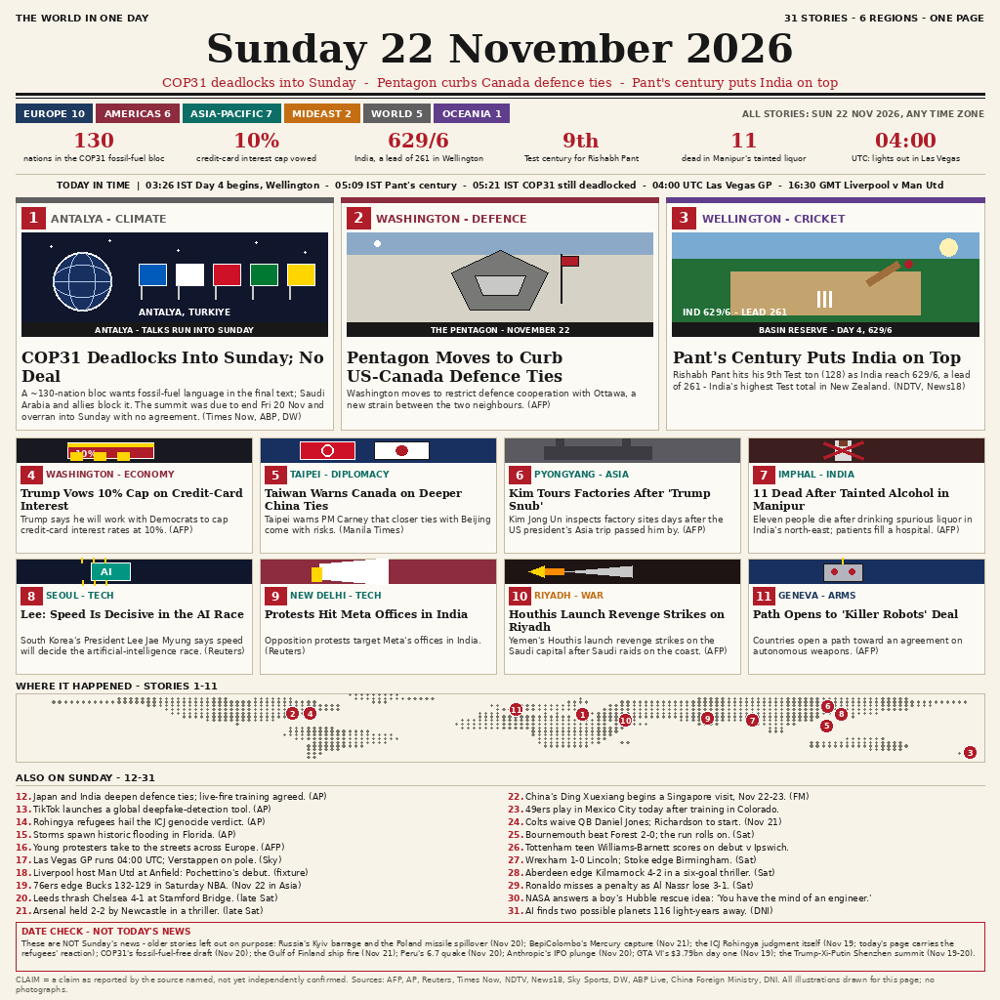

# Sunday 22 November 2026 — The World in One Image

[](https://make.fun/bounty/news-image-20261122)
[](https://make.fun/bounty/news-image-20261122)
[](https://make.fun/bounty/news-image-20261122)

A one-page newspaper summing up Sunday 22 November 2026's world news in
a single 1024 × 1024 image: **31 sourced stories** — three illustrated
leads, eight numbered grid cards and 20 one-line stories — plus a region
tab strip, a big-number stat strip, a timeline, a dotted world map
marking stories 1–11, and a DATE CHECK box listing older stories
deliberately left out.



## How it works

- `render_page.py` draws `entry.png` deterministically with Pillow:
  masthead and kicker, region tabs whose counts are computed from the
  story tables in the code, the stat strip, the timeline, the lead cards
  with flat drawn art, the grid cards with small drawn art strips, the
  dotted world map (continent outlines + numbered markers), the ALSO ON
  SUNDAY list, the DATE CHECK box and the footer.
- All illustrations are drawn with Pillow shapes for this page; no
  photographs are used. CLAIM means a claim as reported by the source
  named, not yet independently confirmed.
- `main.py` is the competition entry point. It uses only the Python
  standard library and copies the repo's `entry.png` to
  `/output/entry.png`.
- Re-running `render_page.py` produces byte-identical output.

```bash
python3 render_page.py   # writes entry.png (1024 x 1024, under 1 MiB)
python3 main.py          # copies entry.png to /output/entry.png
```

## Sources

AFP, AP, Reuters, Times Now, NDTV, News18, Sky Sports, DW, ABP Live,
China Foreign Ministry, DNI. Full per-story ledger: see
`stories.md` in the build notes (not part of this repo).
